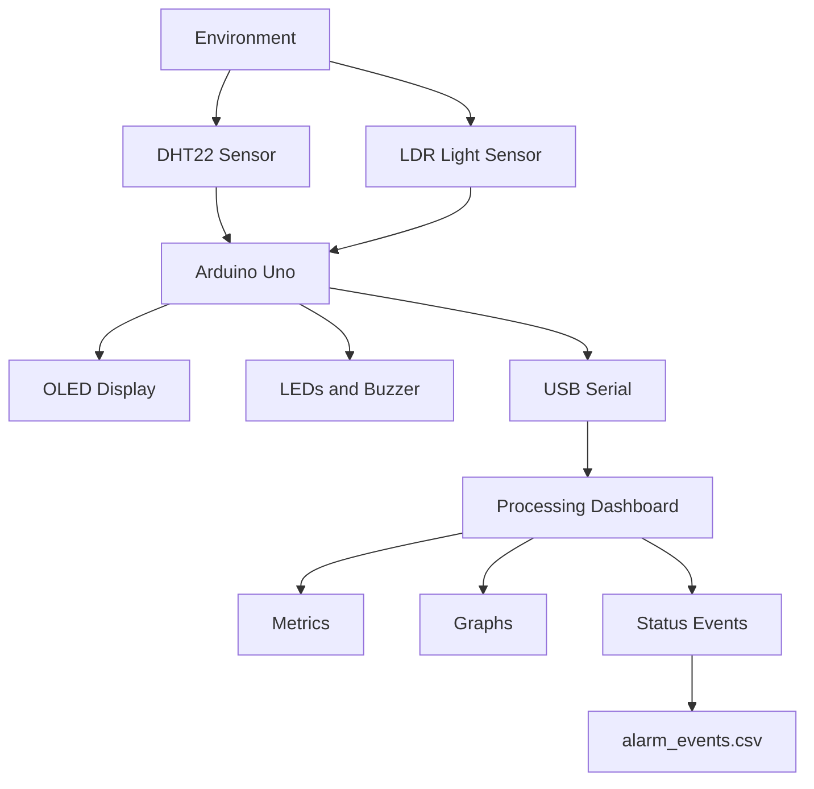

# EnviroGuard

# Real-Time Environmental Monitoring and Alarm System
An Arduino-based environmental monitoring system with a Live Processing dashboard, sensor visualization, alarm management,and timestamped event logging.
EnviroGuard is an embedded systems project developed to monitor environmental conditions using Arduino Uno, a DHT22 temperature and humidity sensor, and a light-dependent resistor (LDR)
The system combines embedded C/C++ programming, electronics, serial communication, real-time data visualization, and CSV event logging. The Arduino monitors  the sensors and controls the physical alarms, while a Processing application displays measurements, plots measuremets history, and records changes in system status.

# Table of Contents
1. Project Objectives
2. Key Features
3. System Architecture
4. Hardware Components
5. Circuit Connections
6. Software Requirements
7. How the System Works
8. Alarm States
9. Serial Communication Protocol
10. Installation and Setup
11. Event Logging
12. Engineering Challenges and Solutions
13. Testing and Verification
14. Current Limitations
15. Future Improvements
16. Skills Demonstrated
17. Project Structure
18. Author

# Project Objectives
The main objectives of the EnviroGuard are to:
1. Monitor Temperature, relative humidity and ambient light.
2. Detect environmental conditions that cross configured alarm threshold.
3. Provide immediate local feedback through buzzer and LEDs.
4. Display live measurements and system status on a desktop dashboard.
5. Visualize recent temperature and humidity measurements.
6. Record status transition in a persistent CSV event log.
7. Practice integrating electronic hardware with embedded and desktop software.

# Key Features
Temperature monitoring using the DHT22.
Relative humidity monitoring.
Ambient light measurement using an LDR.
Real-time desktop dashboard developed with processing.
Temperature and humidity history graph.
Four system states: NORMAL, WARNING, CRITICAL, and SENSOR_FAULT.
Physical status indication using three LEDs.
Buzzer alerts for configured warning and critical conditions.
Timestamped status-transition logging to CSV.
USB serial communication at 9600.
Validation of incoming measurements and detection of stale dashboard data/
OLED display for local monitoring, with a push button for switching screens.

# System Architecture

# Responsibilities
## Arduino Uno
1. Reads temperature, humidity, and light measurements.
2. Evaluate configured thresholds.
3. Determines the system alarm state.
4. Controls LEDs and buzzer.
5. Updates the OLED.
6. Transmits structured sensor data over serial.

## Processing dashboard
1. Receives and parses serial data.
2. Validates measurements and status fields.
3. Displays metrics and measurements history.
4. Detects stale data.
5. Records status transition in a CSV file.

- Alarm decisions are made by the Arduino, so the physical alarm system does not depend on the Processing dashboard being open.

## Hardware Components

| Component | Work (Function) |
|---|---|
| Arduino Uno | Main embedded controller that processes sensor data and controls the output devices. |
| 128 × 64 I²C OLED display | Displays temperature, humidity, ambient light levels, and system status. |
| DHT22/AM3202 | Measures temperature and humidity. |
| Light-dependent resistor (LDR) | Detects ambient light intensity. |
| Green LED | Indicates normal operating conditions. |
| Yellow LED | Indicates a warning condition. |
| Red LED | Indicates a critical condition or sensor fault. |
| Buzzer | Provides audible alerts during warning and critical conditions. |
| Push button | Switches between OLED display screens. |
| Breadboard and jumper wires | Connect the components and allow circuit assembly without soldering. |
| Current-limiting resistors | Limit current through the LEDs to prevent damage. |
| USB cable | Supplies power to the Arduino Uno and enables programming and serial communication. |

# Circuit Connection
## Circuit Connections

The following table documents the pin assignments used in the firmware.

| Component         | Arduino pin |
|-------------------|-------------|
| DHT22 data        | D2          |
| Push button       | D3          |
| LDR analog output | A0          |
| Green LED         | D9          |
| Yellow LED        | D10         |
| Red LED           | D11         |
| Buzzer            | D8          |
| OLED SDA          | A4          |
| OLED SCL          | A5          |
| OLED I²C address  | 0x3C        |

## Wiring notes

- The push button uses the Arduino's internal pull-up configuration (`INPUT_PULLUP`).
- The LDR must be connected in a suitable voltage-divider circuit for analog measurement.
- Verify the DHT22 pinout and OLED connections before powering the circuit.
- Check the current requirements of all components before powering from the arduino.

# Software Requirements
## Development tools

- Arduino IDE
- Processing IDE in Java mode
- A laptop with a compatible USB serial connection

## Arduino libraries

- Install the following libraries through the Arduino IDE Library Manager:
1. Adafruit GFX Library
2. Adafruit SSD1306
3. DHT sensor library

# How the System Works
## 1. Sensor acquisition
- The Arduino reads temperature and relative humidity from the DHT22 and obtains an analog reading from the LDR.
- The DHT22 measurements are checked for validity before being used for alarm decisions.

## 2. Threshold evaluation
- The firmware compares valid sensor readings against configured thresholds. It then assigns the appropriate status.

  The current configuration includes:
  - Warning temperature threshold: 30°C
  - Critical temperature threshold: 35°C
  - Low humidity threshold: 25%
  - High humidity threshold: 75%

## 3. Physical alarms
The Arduino controls the LEDs and buzzer according to the current state.

- NORMAL: Green LED
- WARNING: Yellow LED and an intermittent buzzer pattern
- CRITICAL: Flashing red LED and a faster buzzer pattern
- SENSOR_FAULT: Red LED to indicate a sensor fault

## 4. Serial Transmission
- The Arduino transmits sensor data as a six-field, comma-separated row.
- Processing reads each row, checks the data, and update the dashboard.

## 5. Dashboard visualization
The Processing interface provides.
- Temperature metric card
- Humidity metric card
- Ambient-light ADC metric card
- Current system status
- Recent status events
- Temperature and humidity history graphs
- Connection-state indication

# Alarm States

| State | Meaning | Intended indication |
|---|---|---|
| `NORMAL` | Measurements are within configured limits | Green LED |
| `WARNING` | A configured warning threshold has been crossed | Yellow LED and intermittent buzzer |
| `CRITICAL` | Critical temperature threshold has been reached | Flashing red LED and faster buzzer |
| `SENSOR_FAULT` | Sensor readings are invalid or unavailable | Red LED |

# Serial Communication Protocol
- The Arduino transmits six comma-separated fields at 9600 baud:
  time_ms,temperature_c,humidity_percent,ldr_adc,status,sensor_ok

- An illustrative row is:
12500,30.6,61.2,164,WARNING,1

| Field | Description |
|---|---|
| `time_ms` | Elapsed time reported by the Arduino, in milliseconds. |
| `temperature_c` | Temperature in degrees Celsius. |
| `humidity_percent` | Relative humidity percentage. |
| `ldr_adc` | Light-dependent resistor (LDR) analog-to-digital converter reading. |
| `status` | Current alarm state. |
| `sensor_ok` | Indicates whether sensor data is valid: `1` for valid data and `0` for invalid data. |

Important: Close the Arduino Serial Monitor before launching processing. These two applications normally cannot access the same serial port simultaneously.

# Installation and Setup

## Step 1 - Assemble the hardware
- Connect the Arduino, DHT22, LDR, OLED, LEDs, buzzer, and push button according to the pin table.

## Step 2 - Install Arduino dependancies
- Open the Arduino IDE and install the required libraries using the Library manager.

## Step 3 - Upload the Arduino firmware
1. Open EnviroGuard.ino
2. Select the correct Arduino board and serial port
3. Compile the sketch
4. Upload it to the Arduino Uno
5. Confirm that the hardware operates as expected.

## Step 4 - Configure processing
1. Open the processing dashboard sketch.
2. Locate the SERIAL_PORT setting.
3. Select the correct port as assigned by your Arduino.
4. Ensure that the baud rate matches the firmware: 9600

## Step 5 - Run the Dashboard
1. Close Arduino Serial Monitor and other applications using the Arduino serial port.
2. Start the processing sketch.
3. Confirm that the dashboard receives data.
4. Observe the temperature, humidity, light level, and system state.
5. Check that the event log is created in the processing sketch's folder

## Verify the system
- Observe normal operation first. Then, using safe and controlled test conditions, verify the configured warning and critical thresholds, sensor-fault handling, and event logging.

# Event logging
- Processing writes status transitions to alarm_events.csv in the sketch's folder.

- THe event logger contains:

  

