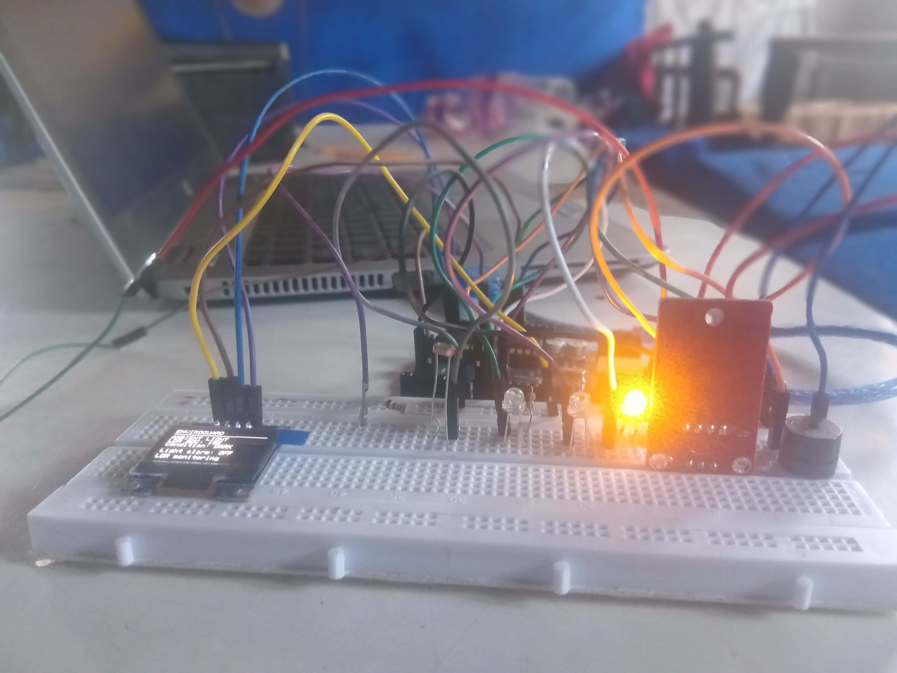
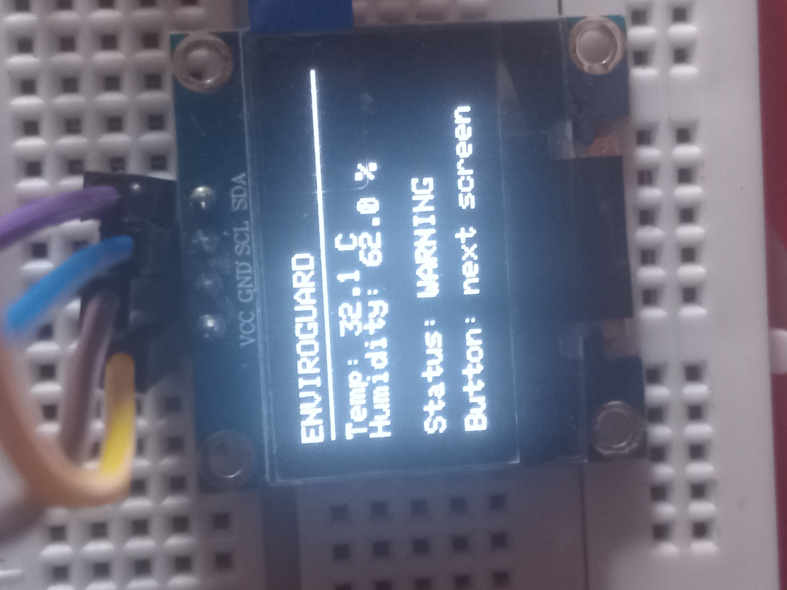
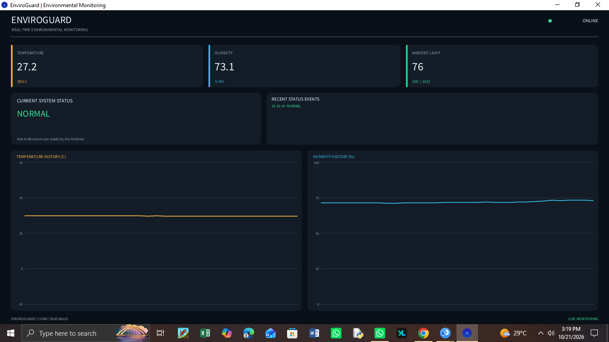
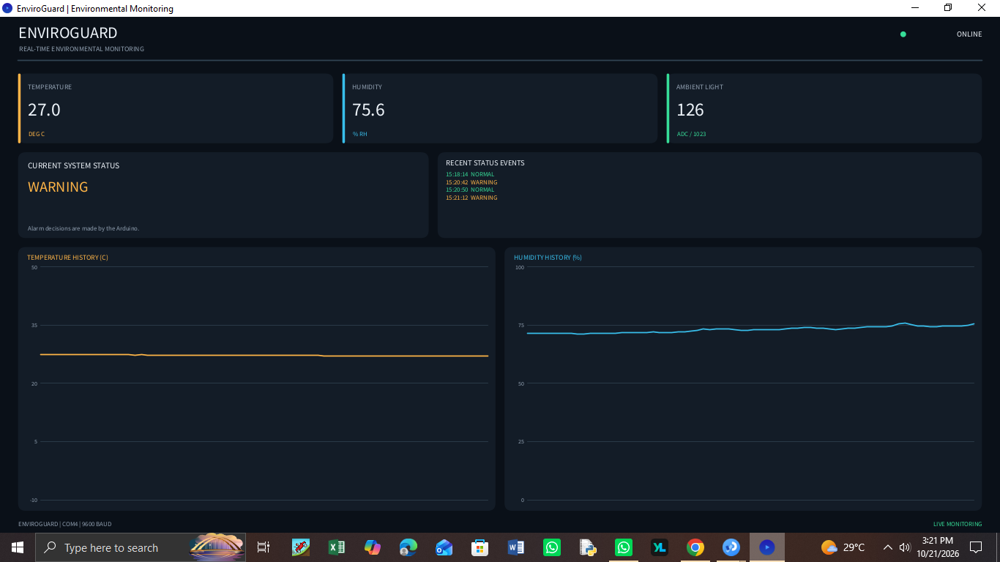
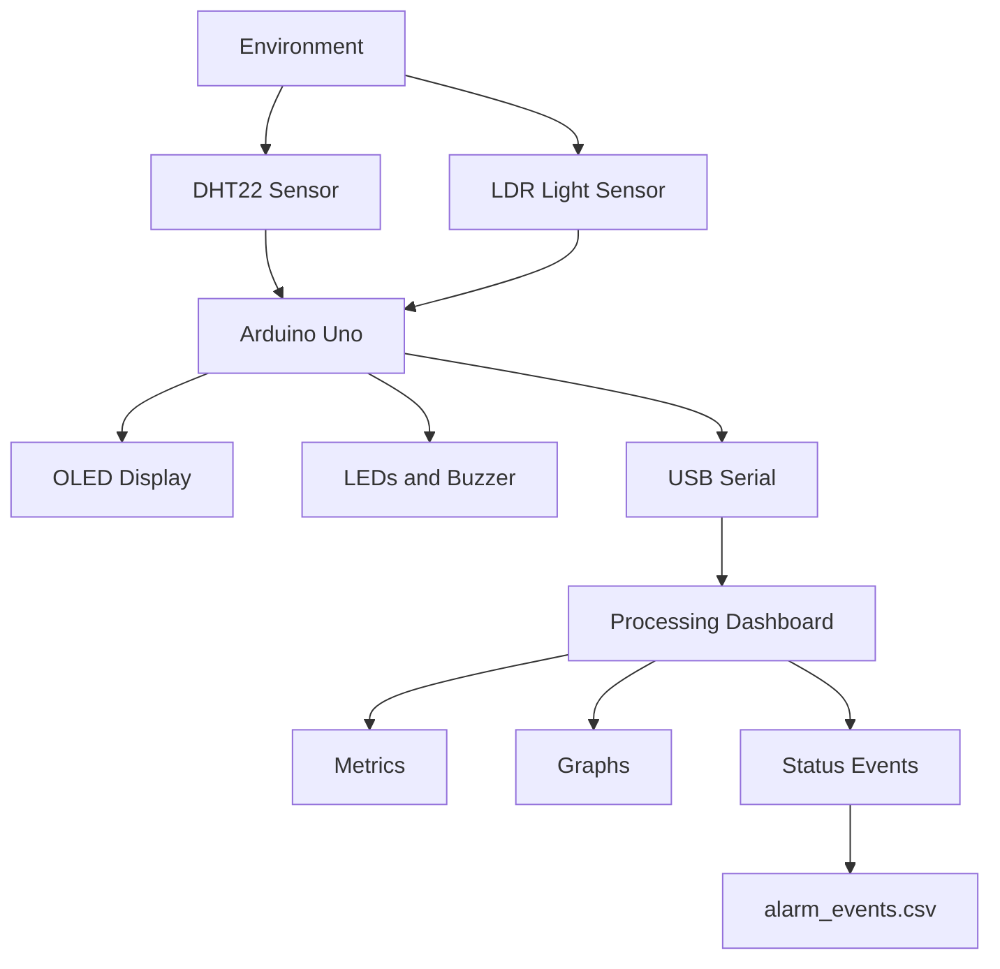

# EnviroGuard

# Real-Time Environmental Monitoring and Alarm System
- An Arduino-based environmental monitoring system with a Live Processing dashboard, sensor visualization, alarm management,and timestamped event logging.
- EnviroGuard is an embedded systems project developed to monitor environmental conditions using Arduino Uno, a DHT22 temperature and humidity sensor, and a light-dependent resistor (LDR)
- The system combines embedded C/C++ programming, electronics, serial communication, real-time data visualization, and CSV event logging. The Arduino monitors  the sensors and controls the physical alarms, while a Processing application displays measurements, plots measurements history, and records changes in system status.

# Table of Contents
1. Project Objectives
2. Key Features
3. Project Demonstration
4. System Architecture
5. Responsibilities
6. Hardware Requirements
7. Circuit Connections
8. Software Requirements
9. How the System Works
10. Alarm states
11. Serial Communication Protocol
12. Installation and Setup
13. Event Logging
14. Engineering Challenges and Solutions
15. Testing and Verification
16. Current Limitations
17. Future Improvements
18. Skills Demonstrated
19. Project Structure
20. Author

# Project Objectives
The main objectives of the EnviroGuard are to:
1. Monitor Temperature, relative humidity and ambient light.
2. Detect environmental conditions that cross configured alarm threshold.
3. Provide immediate local feedback through buzzer and LEDs.
4. Display live measurements and system status on a desktop dashboard.
5. Visualize recent temperature and humidity measurements.
6. Record status transition in a persistent CSV event log.
7. Demonstrate integrating electronic hardware with embedded and desktop software.

# Key Features
- Temperature monitoring using the DHT22.
- Relative humidity monitoring.
- Ambient light measurement using an LDR.
- Real-time desktop dashboard developed with processing.
- Temperature and humidity history graph.
- Four system states: NORMAL, WARNING, CRITICAL, and SENSOR_FAULT.
- Physical status indication using three LEDs.
- Buzzer alerts for configured warning and critical conditions.
- Timestamped status-transition logging to CSV.
- USB serial communication at 9600.
- Validation of incoming measurements and detection of stale dashboard data/
- OLED display for local monitoring, with a push button for switching screens.

# Project demonstration
## Complete Hardware Setup


## OLED Display


## Dashboard - Normal condition


## Dashboard - Warning Condition


# Video Demonstration
- A short demonstration of the EnviroGuard hardware setup and live OLED sensor readings
- github/v85494961-tech/EnviroGuard/issues/1
  

# System Architecture

# Responsibilities
## Arduino Uno
1. Reads temperature, humidity, and light measurements.
2. Evaluate configured thresholds.
3. Determines the system alarm state.
4. Controls LEDs and buzzer.
5. Updates the OLED.
6. Transmits structured sensor data over serial.

## Processing dashboard
1. Receives and parses serial data.
2. Validates measurements and status fields.
3. Displays metrics and measurements history.
4. Detects stale data.
5. Records status transition in a CSV file.

- Alarm decisions are made by the Arduino, so the physical alarm system does not depend on the Processing dashboard being open.

## Hardware Components

| Component | Work (Function) |
|---|---|
| Arduino Uno | Main embedded controller that processes sensor data and controls the output devices. |
| 128 × 64 I²C OLED display | Displays temperature, humidity, ambient light levels, and system status. |
| DHT22/AM2302 | Measures temperature and humidity. |
| Light-dependent resistor (LDR) | Detects ambient light intensity. |
| Green LED | Indicates normal operating conditions. |
| Yellow LED | Indicates a warning condition. |
| Red LED | Indicates a critical condition or sensor fault. |
| Buzzer | Provides audible alerts during warning and critical conditions. |
| Push button | Switches between OLED display screens. |
| Breadboard and jumper wires | Connect the components and allow circuit assembly without soldering. |
| Current-limiting resistors | Limit current through the LEDs to prevent damage. |
| USB cable | Supplies power to the Arduino Uno and enables programming and serial communication. |


# Circuit Connection
## Circuit Connections

The following table documents the pin assignments used in the firmware.

| Component         | Arduino pin |
|-------------------|-------------|
| DHT22 data        | D2          |
| Push button       | D3          |
| LDR analog output | A0          |
| Green LED         | D9          |
| Yellow LED        | D10         |
| Red LED           | D11         |
| Buzzer            | D8          |
| OLED SDA          | A4          |
| OLED SCL          | A5          |
| OLED I²C address  | 0x3C        |

## Wiring notes

- The push button uses the Arduino's internal pull-up configuration (`INPUT_PULLUP`).
- The LDR must be connected in a suitable voltage-divider circuit for analog measurement.
- Verify the DHT22 pinout and OLED connections before powering the circuit.
- Check the current requirements of all components before powering from the arduino.

# Software Requirements
## Development tools

- Arduino IDE
- Processing IDE in Java mode
- A laptop with a compatible USB serial connection

## Arduino libraries

- Install the following libraries through the Arduino IDE Library Manager:
1. Adafruit GFX Library
2. Adafruit SSD1306
3. DHT sensor library

# How the System Works
## 1. Sensor acquisition
- The Arduino reads temperature and relative humidity from the DHT22 and obtains an analog reading from the LDR.
- The DHT22 measurements are checked for validity before being used for alarm decisions.

## 2. Threshold evaluation
- The firmware compares valid sensor readings against configured thresholds. It then assigns the appropriate status.

  The current configuration includes:
  - Warning temperature threshold: 30°C
  - Critical temperature threshold: 35°C
  - Low humidity threshold: 25%
  - High humidity threshold: 75%

## 3. Physical alarms
The Arduino controls the LEDs and buzzer according to the current state.

- NORMAL: Green LED
- WARNING: Yellow LED and an intermittent buzzer pattern
- CRITICAL: Flashing red LED and a faster buzzer pattern
- SENSOR_FAULT: Red LED to indicate a sensor fault

## 4. Serial Transmission
- The Arduino transmits sensor data as a six-field, comma-separated row.
- Processing reads each row, checks the data, and update the dashboard.

## 5. Dashboard visualization
The Processing interface provides.
- Temperature metric card
- Humidity metric card
- Ambient-light ADC metric card
- Current system status
- Recent status events
- Temperature and humidity history graphs
- Connection-state indication

# Alarm States

| State | Meaning | Intended indication |
|---|---|---|
| `NORMAL` | Measurements are within configured limits | Green LED |
| `WARNING` | A configured warning threshold has been crossed | Yellow LED and intermittent buzzer |
| `CRITICAL` | Critical temperature threshold has been reached | Flashing red LED and faster buzzer |
| `SENSOR_FAULT` | Sensor readings are invalid or unavailable | Red LED |

# Serial Communication Protocol
- The Arduino transmits six comma-separated fields at 9600 baud:
  time_ms,temperature_c,humidity_percent,ldr_adc,status,sensor_ok

- An illustrative row is:
12500,30.6,61.2,164,WARNING,1

| Field | Description |
|---|---|
| `time_ms` | Elapsed time reported by the Arduino, in milliseconds. |
| `temperature_c` | Temperature in degrees Celsius. |
| `humidity_percent` | Relative humidity percentage. |
| `ldr_adc` | Light-dependent resistor (LDR) analog-to-digital converter reading. |
| `status` | Current alarm state. |
| `sensor_ok` | Indicates whether sensor data is valid: `1` for valid data and `0` for invalid data. |

Important: Close the Arduino Serial Monitor before launching processing. These two applications normally cannot access the same serial port simultaneously.

# Installation and Setup

## Step 1 - Assemble the hardware
- Connect the Arduino, DHT22, LDR, OLED, LEDs, buzzer, and push button according to the pin table.

## Step 2 - Install Arduino dependancies
- Open the Arduino IDE and install the required libraries using the Library manager.

## Step 3 - Upload the Arduino firmware
1. Open EnviroGuard.ino
2. Select the correct Arduino board and serial port
3. Compile the sketch
4. Upload it to the Arduino Uno
5. Confirm that the hardware operates as expected.

## Step 4 - Configure processing
1. Open the processing dashboard sketch.
2. Locate the SERIAL_PORT setting.
3. Select the correct port as assigned by your Arduino.
4. Ensure that the baud rate matches the firmware: 9600

## Step 5 - Run the Dashboard
1. Close Arduino Serial Monitor and other applications using the Arduino serial port.
2. Start the processing sketch.
3. Confirm that the dashboard receives data.
4. Observe the temperature, humidity, light level, and system state.
5. Check that the event log is created in the processing sketch's folder

## Step 6 - Verify the system
- Observe normal operation first. Then, using safe and controlled test conditions, verify the configured warning and critical thresholds, sensor-fault handling, and event logging.

# Event logging
- Processing writes status transitions to alarm_events.csv in the sketch's folder.

- THe event logger contains:
timestamp, status, temperature_c, humidity_percent,ldr_adc,sensor_ok

- Each record includes a computer-generated timestamp and the measurements available at the time of the transition
- The logger opens the file in append mode, preserving previous records when the sketch is restarted. It flushes the file after writing each event.
- The dashboard's recent-event list displays the latest events during the current session. The graph history is stored in memory and resets when Processing restarts.
- The CSV event log records status transition, not every sensor sample. Continuous measurement logging would be a separate feature for enhancement.

# Engineering Challenges and Solutions

## 1. Resolving the Processing Serial type ambiguity
- Challenge: During development, Processing reported that the type Serial was ambigous, preventing the dashboard from compiling.
- Solution: The sketch was updated to use the fully qualified class name processing.serial.Serial for the serial communication, constructor and callback parameter.
- Engineering lesson: Explicitly qualifying a class name can resolve naming conflicts and make dependancies clearer.

## 2. Handling invalid sensor measurements
- Challenge: Invalid DHT22 measurements can result in unusable values, including NaN. Using such values in a dashboard or alarm calculation can produce misleading results.
- Solution: The firmware checks sensor validity, and Processing validates incoming measurements before processing them as valid readings. Invalid measurements are represented by the SENSOR_FAULT state.
- Engineering lesson - Sensor validation and fault handling parts are important parts of reliable embedded software

## 3. Maintaining a consistent serial data format
- Challenge: The Arduino and Processing application must agree on the number, order, and meaning of the transmitted fields.
- Solution: A six-column CSV protocol is used. Processing checks the field count, validates the status and sensor flag, and checks measurements ranges.
- Engineering lesson: Consistent interfaces and input validation simplify integration between embedded firmware and desktop applications.

## 4. Distinguishing stale data from live measurements
- Challenge: A desktop application can remain open even when communication with the Arduino has stopped.
- Solution: Processing tracks when the latest valid data was received. If no new data arrives within the configured seven-second timeout, the dashboard indicates that the data is no longer fresh.
- Engineering lesson: Monitoring the age of incoming data helps prevent old measurements from being mistaken for current readings.

## 5. Separating alarm decisions from visualization
- Challenge: Making the physical alarm behaviour dependent on the desktop dashboard would reduce the system's independence.
- Solution: The Arduino determines the alarm state and controls the LEDs and buzzer. Processing displays the received status and records its transitions.
- Engineering lesson: Separating embedded control from user-interface responsibilities makes the overall design easier to understand and maintain.

## 6. Preserving important status events
- Challenge: The recent-event panel is temporary, and its contents dissapear when the dashboard restarts.
- Solution: Processing writes status transitions to a CSV file opened in append mode, providing a persistent record of events.
- Engineering lesson: Persistent logging is useful for troubleshooting, evaluating system behavior, and documenting tests.

## 7. Integrating multiple hardware and software components.
- Challenge: The project combines multiple sensors, an OLED, physical alarms, serial communication, and a graphical application. each part must work with consistent pin assignments and expected behavior.
- Solution: The firmware uses defined pin assignments and a common serial protocol, while the Processing sketch manages visualization and event logging.
- Engineering lesson: Hardware/software integration requires systematic testing of individual components as well as the complete system.

# Current Limitations
- The current event log records status transitions rather than every sensor measurement.
- Dashboard graph history resets when Processing restarts.
- The serial port setting may require manual adjustment on dgital comupters.
- The desktop dashboard requires a USB serial connection to the Arduino.
- Light measurements are collected, but light-based alarms are disabled in the current configuartion.
- An OLED initialization failure is reported diagnostically, but the dashboard does not currently receive a dedicated OLED faukt status.
- Thresholds are configured in the firmware rather than changed dynamically from the dashboard.

# Future Improvements
Planned improvements include:
- Improve reporting of individual peripheral failures.
- Add a configurable threshold system.
- Add continuous sensor-data logging an optional mode.
- Develop tools for analyzing long term environmental trends.
- Add wireless monitoring through an appropriate IoT platform.
- Improve automated testing of serial parsing and alarm-state transitions.
- Evaluate additional environmental sensors and use cases.

# Skills Demonstrated
This project provides practical experience in:
- Embedded C/C++ programming
- Arduino microcontroller development.
- Temperature, humidity, and light sensing.
- Analog measurements and digital I/O
- I²C peripheral interfacing
- Serial communication and and CSV parsing
- Real-time dashboard development with processing
- Data visualization and graphing.
- Sate-based alarm logic
- Sensor validation and basic fault handling
- File handling and persistent event logging
- Hardware/software integration and debugging
- Technical documentation and version control Github

# Project Structure
## Project Structure

```text
EnviroGuard/
├── Images/
│   ├── circuit_setup.jpg
│   ├── oled_display.jpg
│   ├── dashboard_normal.png
│   └── dashboard_warning.png
├── EnviroGuard.ino
├── EnviGuardDashboard.pde
└── README.md
```

### File Descriptions

- **Images/** — Circuit photographs, OLED display images, and dashboard screenshots.
- **circuit_setup.jpg** — Photograph of the hardware circuit setup.
- **oled_display.jpg** — Image of the OLED display showing sensor readings.
- **dashboard_normal.png** — Screenshot of the dashboard in normal operating mode.
- **dashboard_warning.png** — Screenshot of the dashboard in warning mode.
- **EnviroGuard.ino** — Arduino firmware for sensor readings, OLED updates, and alarm control.
- **EnviroGuardDashboard.pde** — Processing application for the graphical dashboard and real-time monitoring.
- **README.md** — Project overview, setup instructions, and documentation.
  
# Author
Vincent Panyako Ingoi

- Electrical and Communication Engineering student interested in embedded systems, electronics, and IoT.
- This project was developed as a hands-on learning exercise in integrating embedded hardware, real-time monitoring, and desktop visualization.

EnviroGuard - Connecting embedded electronics with real-time environmental awareness.


  


