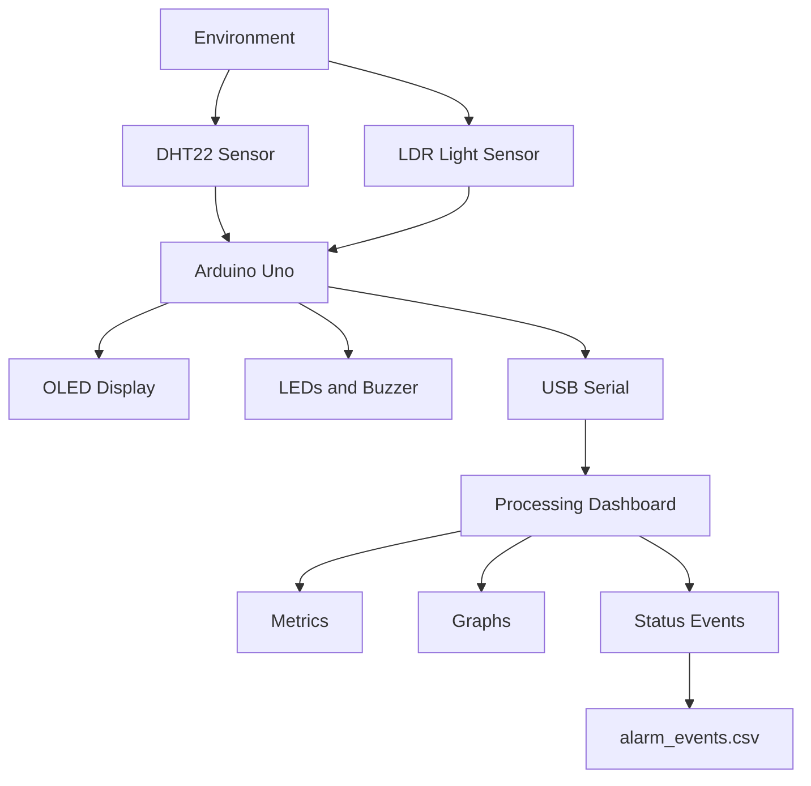

# EnviroGuard

# Real-Time Environmental Monitoring and Alarm System
An Arduino-based environmental monitoring system with a Live Processing dashboard, sensor visualization, alarm management,and timestamped event logging.
EnviroGuard is an embedded systems project developed to monitor environmental conditions using Arduino Uno, a DHT22 temperature and humidity sensor, and a light-dependent resistor (LDR)
The system combines embedded C/C++ programming, electronics, serial communication, real-time data visualization, and CSV event logging. The Arduino monitors  the sensors and controls the physical alarms, while a Processing application displays measurements, plots measuremets history, and records changes in system status.

# Table of Contents
1. Project Objectives
2. Key Features
3. System Architecture
4. Hardware Components
5. Circuit Connections
6. Software Requirements
7. How the System Works
8. Alarm States
9. Serial Communication Protocol
10. Installation and Setup
11. Event Logging
12. Engineering Challenges and Solutions
13. Testing and Verification
14. Current Limitations
15. Future Improvements
16. Skills Demonstrated
17. Project Structure
18. Author

# Project Objectives
The main objectives of the EnviroGuard are to:
1. Monitor Temperature, relative humidity and ambient light.
2. Detect environmental conditions that cross configured alarm threshold.
3. Provide immediate local feedback through buzzer and LEDs.
4. Display live measurements and system status on a desktop dashboard.
5. Visualize recent temperature and humidity measurements.
6. Record status transition in a persistent CSV event log.
7. Practice integrating electronic hardware with embedded and desktop software.

# Key Features
Temperature monitoring using the DHT22.
Relative humidity monitoring.
Ambient light measurement using an LDR.
Real-time desktop dashboard developed with processing.
Temperature and humidity history graph.
Four system states: NORMAL, WARNING, CRITICAL, and SENSOR_FAULT.
Physical status indication using three LEDs.
Buzzer alerts for configured warning and critical conditions.
Timestamped status-transition logging to CSV.
USB serial communication at 9600.
Validation of incoming measurements and detection of stale dashboard data/
OLED display for local monitoring, with a push button for switching screens.

# System Architecture

# Responsibilities
# Arduino Uno
1. Reads temperature, humidity, and light measurements.
2. Evaluate configured thresholds.
3. Determines the system alarm state.
4. Controls LEDs and buzzer.
5. Updates the OLED.
6. Transmits structured sensor data over serial.

# Processing dashboard
1. Receives and parses serial data.
2. Validates measurements and status fields.
3. Displays metrics and measurements history.
4. Detects stale data.
5. Records status transition in a CSV file.

Alarm decisions are made by the Arduino, so the physical alarm system does not depend on the Processing dashboard being open.

# Hardware components
Arduino Uno - Main embedded controller
128 × 64 I²C OLED display - local measurement display
DHT22/AM3202 - Temperature and humidity measurement
Light-dependent resistor(LDR) - Ambient light sensing
Green LED - Normal operating indication
Yellow LED - Warning indication
Red lED - Critical or sensor_fault indication
Buzzer - Audible warning and critical alerts
Push button - Switches OLED display screens
Breadboard and jumper wires - Circuit assembly
Current-limiting resistors - LED protection
USB cable - power, programming and serial communication

# Circuit Connection
## Circuit Connections

The following table documents the pin assignments used in the firmware.

| Component         | Arduino pin |
|-------------------|-------------|
| DHT22 data        | D2          |
| Push button       | D3          |
| LDR analog output | A0          |
| Green LED         | D9          |
| Yellow LED        | D10         |
| Red LED           | D11         |
| Buzzer            | D8          |
| OLED SDA          | A4          |
| OLED SCL          | A5          |
| OLED I²C address  | 0x3C        |

## Wiring notes

- The push button uses the Arduino's internal pull-up configuration (`INPUT_PULLUP`).
- The LDR must be connected in a suitable voltage-divider circuit for analog measurement.
- Verify the DHT22 pinout and OLED connections before powering the circuit.
-

